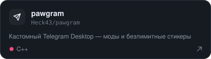
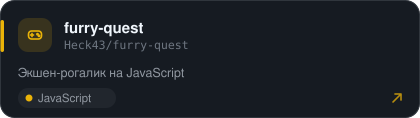
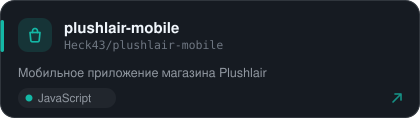
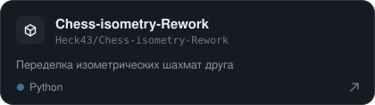
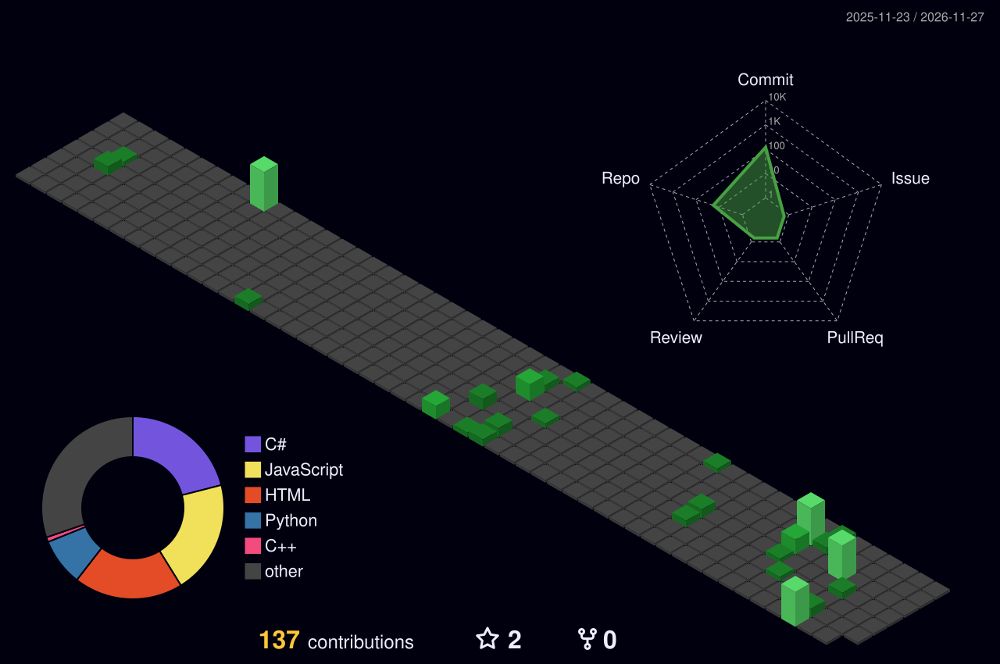

# heck43 

18 · Top Academy (3 курс) · Кострома

[<kbd>&nbsp;heck43.github.io&nbsp;</kbd>](https://heck43.github.io)
[<kbd>&nbsp;Telegram&nbsp;</kbd>](https://t.me/Heck1337)
[<kbd>&nbsp;Discord&nbsp;</kbd>](https://discord.gg/BMTCDDbpFh)
[<kbd>&nbsp;Email&nbsp;</kbd>](mailto:lolnektyr@gmail.com)

 

### Проекты

  <a href="https://github.com/Heck43/pawgram">
    <picture>
      <source media="(prefers-color-scheme: dark)" srcset="./assets/dark/pawgram.svg" />
      <source media="(prefers-color-scheme: light)" srcset="./assets/light/pawgram.svg" />
      
    </picture>
  </a>
  <a href="https://github.com/Heck43/Pawgram-Android">
    <picture>
      <source media="(prefers-color-scheme: dark)" srcset="./assets/dark/Pawgram-Android.svg" />
      <source media="(prefers-color-scheme: light)" srcset="./assets/light/Pawgram-Android.svg" />
      
    </picture>
  </a>
  <a href="https://github.com/Heck43/furry-quest">
    <picture>
      <source media="(prefers-color-scheme: dark)" srcset="./assets/dark/furry-quest.svg" />
      <source media="(prefers-color-scheme: light)" srcset="./assets/light/furry-quest.svg" />
      
    </picture>
  </a>
  <a href="https://github.com/Heck43/mcp-arma3">
    <picture>
      <source media="(prefers-color-scheme: dark)" srcset="./assets/dark/mcp-arma3.svg" />
      <source media="(prefers-color-scheme: light)" srcset="./assets/light/mcp-arma3.svg" />
      
    </picture>
  </a>
  <a href="https://github.com/Heck43/plushlair-mobile">
    <picture>
      <source media="(prefers-color-scheme: dark)" srcset="./assets/dark/plushlair-mobile.svg" />
      <source media="(prefers-color-scheme: light)" srcset="./assets/light/plushlair-mobile.svg" />
      
    </picture>
  </a>
  <a href="https://github.com/Heck43/Chess-isometry-Rework">
    <picture>
      <source media="(prefers-color-scheme: dark)" srcset="./assets/dark/Chess-isometry-Rework.svg" />
      <source media="(prefers-color-scheme: light)" srcset="./assets/light/Chess-isometry-Rework.svg" />
      
    </picture>
  </a>

### Стек и интересы

**Языки** &nbsp; <kbd>Python</kbd> <kbd>C#</kbd> <kbd>C++</kbd> <kbd>JavaScript</kbd> <kbd>Java</kbd> <kbd>Luau</kbd>

**Игры** &nbsp; <kbd>Minecraft</kbd> <kbd>Postal 2</kbd> <kbd>ATLYSS</kbd> <kbd>Roblox</kbd>

**Интересы** &nbsp; кодинг, игры, фурри-движ, моды под клиенты и пет-проекты

### Активность

<picture>
  <source media="(prefers-color-scheme: dark)" srcset="./profile-3d-contrib/profile-night-green.svg" />
  <source media="(prefers-color-scheme: light)" srcset="./profile-3d-contrib/profile-green.svg" />
  
</picture>
