<picture><source media="(prefers-color-scheme: dark)" srcset="assets/hero-dark.svg"></picture>

<picture><source media="(prefers-color-scheme: dark)" srcset="assets/social-l-dark.svg"></picture><a href="https://t.me/Heck1337"><picture><source media="(prefers-color-scheme: dark)" srcset="assets/social-1-dark.svg"></picture></a><a href="https://steamcommunity.com/id/heck1337/"><picture><source media="(prefers-color-scheme: dark)" srcset="assets/social-2-dark.svg"></picture></a><a href="https://discord.gg/BMTCDDbpFh"><picture><source media="(prefers-color-scheme: dark)" srcset="assets/social-3-dark.svg"></picture></a><picture><source media="(prefers-color-scheme: dark)" srcset="assets/social-r-dark.svg"></picture>

<a href="https://github.com/Heck43/antigravity-web-studio"><picture><source media="(prefers-color-scheme: dark)" srcset="assets/project-antigravity-web-studio-dark.svg"></picture></a>&nbsp;<a href="https://github.com/Heck43/cpp-journey"><picture><source media="(prefers-color-scheme: dark)" srcset="assets/project-cpp-journey-dark.svg"></picture></a>

<a href="https://github.com/Heck43/Chess-isometry-Rework"><picture><source media="(prefers-color-scheme: dark)" srcset="assets/project-chess-isometry-rework-dark.svg"></picture></a>&nbsp;<a href="https://github.com/Heck43/aim_trainer_for_heck43"><picture><source media="(prefers-color-scheme: dark)" srcset="assets/project-aim-trainer-for-heck43-dark.svg"></picture></a>

<a href="https://github.com/Heck43/Bouncing-Balls-Widget"><picture><source media="(prefers-color-scheme: dark)" srcset="assets/project-bouncing-balls-widget-dark.svg"></picture></a>&nbsp;<a href="https://github.com/Heck43/kjughegwoih"><picture><source media="(prefers-color-scheme: dark)" srcset="assets/project-kjughegwoih-dark.svg"></picture></a>

<picture><source media="(prefers-color-scheme: dark)" srcset="assets/stack-dark.svg"></picture>

<picture><source media="(prefers-color-scheme: dark)" srcset="assets/stats-dark.svg"></picture>

<picture><source media="(prefers-color-scheme: dark)" srcset="assets/streak-dark.svg"></picture>

<picture><source media="(prefers-color-scheme: dark)" srcset="assets/wave-dark.svg"></picture>

<a href="https://heck43.github.io"><picture><source media="(prefers-color-scheme: dark)" srcset="assets/button-1-dark.svg"></picture></a>&nbsp;&nbsp;<a href="https://github.com/Heck43?tab=repositories"><picture><source media="(prefers-color-scheme: dark)" srcset="assets/button-2-dark.svg"></picture></a>

<a href="https://metawka.github.io/expressive-profile/?from=Heck43"><picture><source media="(prefers-color-scheme: dark)" srcset="assets/credit-dark.svg"></picture></a>

