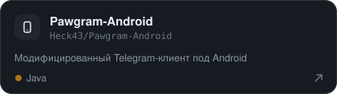
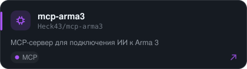

<h3>heck43 </h3>

18 лет · Top Academy (3 курс) · Кострома · делаю моды под Telegram, игры и пет-проекты

[<kbd>&nbsp;heck43.github.io&nbsp;</kbd>](https://heck43.github.io)&nbsp;[<kbd>&nbsp;Telegram&nbsp;</kbd>](https://t.me/Heck1337)&nbsp;[<kbd>&nbsp;Discord&nbsp;</kbd>](https://discord.gg/BMTCDDbpFh)&nbsp;[<kbd>&nbsp;Email&nbsp;</kbd>](mailto:lolnektyr@gmail.com)

 

### Проекты

<a href="https://github.com/Heck43/pawgram"><picture><source media="(prefers-color-scheme: dark)" srcset="./assets/dark/pawgram.svg" /><source media="(prefers-color-scheme: light)" srcset="./assets/light/pawgram.svg" /></picture></a> <a href="https://github.com/Heck43/Pawgram-Android"><picture><source media="(prefers-color-scheme: dark)" srcset="./assets/dark/Pawgram-Android.svg" /><source media="(prefers-color-scheme: light)" srcset="./assets/light/Pawgram-Android.svg" /></picture></a> <a href="https://github.com/Heck43/furry-quest"><picture><source media="(prefers-color-scheme: dark)" srcset="./assets/dark/furry-quest.svg" /><source media="(prefers-color-scheme: light)" srcset="./assets/light/furry-quest.svg" /></picture></a> <a href="https://github.com/Heck43/mcp-arma3"><picture><source media="(prefers-color-scheme: dark)" srcset="./assets/dark/mcp-arma3.svg" /><source media="(prefers-color-scheme: light)" srcset="./assets/light/mcp-arma3.svg" /></picture></a> <a href="https://github.com/Heck43/plushlair-mobile"><picture><source media="(prefers-color-scheme: dark)" srcset="./assets/dark/plushlair-mobile.svg" /><source media="(prefers-color-scheme: light)" srcset="./assets/light/plushlair-mobile.svg" /></picture></a> <a href="https://github.com/Heck43/Chess-isometry-Rework"><picture><source media="(prefers-color-scheme: dark)" srcset="./assets/dark/Chess-isometry-Rework.svg" /><source media="(prefers-color-scheme: light)" srcset="./assets/light/Chess-isometry-Rework.svg" /></picture></a>

### Стек и игры

<picture>
  <source media="(prefers-color-scheme: dark)" srcset="https://skillicons.dev/icons?i=py,cs,cpp,js,java,lua,git,vscode,visualstudio&theme=dark" />
  <source media="(prefers-color-scheme: light)" srcset="https://skillicons.dev/icons?i=py,cs,cpp,js,java,lua,git,vscode,visualstudio&theme=light" />
  
</picture>

 

**Играю в** &nbsp; <kbd>Minecraft</kbd> <kbd>Postal 2</kbd> <kbd>ATLYSS</kbd> <kbd>Roblox</kbd>

### Активность

<picture>
  <source media="(prefers-color-scheme: dark)" srcset="https://raw.githubusercontent.com/Heck43/Heck43/output/pacman-contribution-graph-dark.svg" />
  <source media="(prefers-color-scheme: light)" srcset="https://raw.githubusercontent.com/Heck43/Heck43/output/pacman-contribution-graph.svg" />
  
</picture>
