<picture><source media="(prefers-color-scheme: dark)" srcset="assets/hero-dark.svg"></picture>

<picture><source media="(prefers-color-scheme: dark)" srcset="assets/social-l-dark.svg"></picture><a href="https://t.me/Heck1337"><picture><source media="(prefers-color-scheme: dark)" srcset="assets/social-1-dark.svg"></picture></a><a href="https://steamcommunity.com/id/heck1337/"><picture><source media="(prefers-color-scheme: dark)" srcset="assets/social-2-dark.svg"></picture></a><a href="https://discord.gg/BMTCDDbpFh"><picture><source media="(prefers-color-scheme: dark)" srcset="assets/social-3-dark.svg"></picture></a><picture><source media="(prefers-color-scheme: dark)" srcset="assets/social-r-dark.svg"></picture>

<a href="https://github.com/Heck43/pawgram"><picture><source media="(prefers-color-scheme: dark)" srcset="assets/project-pawgram-dark.svg"></picture></a>&nbsp;<a href="https://github.com/Heck43/furry-quest"><picture><source media="(prefers-color-scheme: dark)" srcset="assets/project-furry-quest-dark.svg"></picture></a>

<a href="https://github.com/Heck43/mcp-arma3"><picture><source media="(prefers-color-scheme: dark)" srcset="assets/project-mcp-arma3-dark.svg"></picture></a>&nbsp;<a href="https://github.com/Heck43/Chess-isometry-Rework"><picture><source media="(prefers-color-scheme: dark)" srcset="assets/project-chess-isometry-rework-dark.svg"></picture></a>

<picture><source media="(prefers-color-scheme: dark)" srcset="assets/stack-dark.svg"></picture>

<picture><source media="(prefers-color-scheme: dark)" srcset="assets/stats-dark.svg"></picture>

<a href="https://heck43.github.io"><picture><source media="(prefers-color-scheme: dark)" srcset="assets/button-1-dark.svg"></picture></a>&nbsp;&nbsp;<a href="https://github.com/Heck43?tab=repositories"><picture><source media="(prefers-color-scheme: dark)" srcset="assets/button-2-dark.svg"></picture></a>

<a href="https://metawka.github.io/expressive-profile/?from=Heck43"><picture><source media="(prefers-color-scheme: dark)" srcset="assets/credit-dark.svg"></picture></a>

